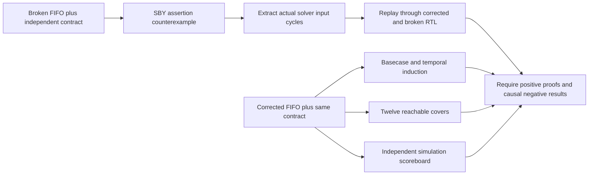

# Formal FIFO: counterexample, replay and safety proof

This demonstration finds a simultaneous-transfer occupancy bug in a four-entry, eight-bit synchronous FIFO, replays the solver's actual inputs in simulation, and proves the corrected implementation. **Crucible is beta.** The managed SymbiYosys bundle supplies the proof frontend and SMT dependencies; Icarus Verilog supplies an independent simulation route.

- [Quick start](#quick-start)
- [How it works](#how-it-works)
- [What runs](#what-runs)
- [Repository layout](#repository-layout)
- [Individual stages](#individual-stages)
- [Results and controls](#results-and-controls)
- [Troubleshooting](#troubleshooting)
- [Reports and limits](#reports-and-limits)
- [Licence](#licence)

The reviewed [eleven-page PDF](docs/Formal_FIFO_Counterexample_and_Proof_Ignytion_A4.pdf) and [editable A4 PowerPoint](docs/Formal_FIFO_Counterexample_and_Proof_Ignytion_A4.pptx) explain the contract, counterexample and proof limits. [Recorded results](evidence/summary.json), [counterexample states](evidence/counterexample.csv) and [document hashes](evidence/documents.sha256.json) are included. Raw proof directories and logs are regenerated locally and ignored by Git.

## Recorded results and their scope

Measured locally on 1 November 2026:

| Check | Observed result |
|---|---|
| Preserved broken RTL | Occupancy assertion fails at formal step 4; SBY exits 2 |
| Corrected RTL safety | Basecase and temporal induction pass in `prove` mode |
| Reachability | All 12 cover statements reached, within 10 formal steps |
| Independent simulation | 2,195 cycles and 13,170 comparisons pass |
| Concrete witness replay | Corrected RTL passes five cycles and 30 comparisons |
| Broken simulation and replay | Both reject occupancy 2 when the reference expects 1; each exits 1 |

The proof establishes unbounded safety under the stated abstract single-clock/reset model for this exact fixed configuration. A depth of 16 supports induction; the result includes a successful induction step. It is not only a sixteen-cycle bounded check. Cover steps are abstract solver indices, not physical latency measurements.

## Interface and acceptance contract

`rtl/fifo.v` defines module `fifo`. Its inputs are `clk`, synchronous active-high `rst`, `wr_en`, eight-bit `wr_data` and `rd_en`. Outputs are eight-bit registered `rd_data`, registered `rd_valid`, `full`, `empty` and three-bit `level`.

Requests are accepted using occupancy **before** the rising edge: a write requires `wr_en && !full`, and a read requires `rd_en && !empty`.

| Pre-edge state | Both requests asserted | Result |
|---|---|---|
| Empty | Write accepted; read rejected | Occupancy becomes one; no valid read |
| Full | Read accepted; write rejected | Occupancy becomes three |
| Between empty and full | Both accepted | Oldest byte read; new byte appended; occupancy unchanged |

An accepted read asserts `rd_valid` and returns the oldest queued byte after the edge. Otherwise `rd_valid` is low and `rd_data` holds its previous value. Reset clears pointers, occupancy, valid and read data, discarding queued bytes. Unoccupied memory is not reset. There is no fall-through or full-through bypass.

The formal environment assumes reset on the first formal edge only. Later resets, requests and every data bit remain unconstrained. The shift-queue reference decides acceptance from its own count, independently of DUT flags. Pointer and occupied-memory relations are assertions proved with the safety properties, not assumptions that the DUT is correct.

## Quick start

Open a Linux/WSL terminal in this repository root. Crucible is beta. Linux x86-64/WSL, an existing Crucible beta installation and network access for initial locked-tool acquisition. The managed SBY bundle includes its Yosys/SMT dependencies. The observer uses only Python standard-library modules; no PDK, FPGA board or separate solver installation is required.

```sh
igny init
igny workspace sync
igny tool install make --version 4.4.1 --env formal-fifo
igny run --env formal-fifo make setup
igny run --env formal-fifo make check
```

The exact fixed four-entry/eight-bit configuration and reset/acceptance contract above are the proof scope. Keep the deliberate broken fixture. A compiler error, missing solver or timeout is not an expected counterexample.

Run the complete experiment after satisfying those prerequisites:

```sh
igny run --env formal-fifo make run
```

Every executable example in this guide goes through Igny. Make delegates to the supplied stage scripts and observers; failed stages stop the workflow. Make 4.4.1 is installed separately from the existing engineering-tool lock. The setup target only checks Python standard-library availability. The check target checks observer imports; it does not qualify a PDK or native-library installation.

## How it works

The deliberate bug increments occupancy on a simultaneous accepted read/write. A shift-queue reference accepts requests from its own count, allowing the solver to expose the mismatch. The corrected FIFO is checked by basecase and temporal induction, while concrete witness inputs are replayed through both implementations in an independent simulator.



## What runs

| Component | Pinned version |
|---|---|
| iverilog | 14.0.0 |
| symbiyosys | 0.63.0 |

The lock restores those engineering tools; the setup target prepares only project-local observer dependencies where needed. Initial acquisition may require network access. Native Windows/macOS/ARM tool execution and independent clean-machine reproduction are not established by these results.

## Repository layout

```text
.
|-- Makefile             Managed workflow entry points
|-- crucible.toml        Workspace selection
|-- crucible.lock        Engineering-tool identities
|-- rtl/                 Corrected FIFO
|-- formal/              Independent contract and broken/prove/cover tasks
|-- tests/               Broken fixture and independent simulation/replay bench
|-- scripts/             Witness extraction, verification and managed workflow
|-- docs/                Reviewed PDF and editable PowerPoint
|-- evidence/            Compact reviewed measurement snapshots
`-- build/               Generated local artifacts; ignored by Git
```

## Individual stages

Run these from the same prepared workspace. Stages use earlier outputs; execute them in the listed order when reproducing the flow manually. The run target performs the full ordered workflow.

| Managed command | Work performed |
|---|---|
| `igny run --env formal-fifo make identity` | Record managed SBY and simulator identities |
| `igny run --env formal-fifo make broken` | Require the real occupancy assertion failure and retain its witness |
| `igny run --env formal-fifo make prove` | Prove corrected safety with basecase and temporal induction |
| `igny run --env formal-fifo make cover` | Reach every one of twelve behaviours |
| `igny run --env formal-fifo make sim` | Extract/replay the real witness and run corrected/broken independent simulations |

Inspect or recheck existing results without rebuilding:

```sh
igny run --env formal-fifo make smoke
igny run --env formal-fifo make report
igny run --env formal-fifo make help
```

The smoke target validates existing generated evidence. It is not a new experiment run. The report target prints local summaries and fails if required results are absent. The sed target normalises only public shell inputs to LF; run invokes it automatically.

## Results and controls

Require FIFO_UNBOUNDED_PROOF_COVERS_CAUSAL_COUNTEREXAMPLE_AND_SIMULATION_VERIFIED. The corrected regression checks 2,195 cycles and 13,170 comparisons; witness replay checks five cycles and 30 comparisons. Broken simulation and replay must reject occupancy 2 when the independent reference expects 1. Require both basecase and induction success; a bounded depth alone is insufficient. All twelve cover goals must be reached.

Expected negative failures are handled by the existing runners/observers. Missing tools, compilation failures, timeouts and missing artifacts do not count as successful controls. Changing sources or inputs requires rerunning the affected stages and their dependents. Raw logs and generated runtime/PDK payloads remain local.

## Troubleshooting

| Symptom | Check / next action |
|---|---|
| Wrong workspace or missing tool | Open the terminal in the root containing crucible.toml; use the explicit project environment in this guide and restore the lock. |
| Make is not bound | Repeat the managed Make installation in Quick start. |
| Observer dependency is absent or changed | Repeat the managed setup target; retain the pinned requirements. |
| Native library or PDK is missing | Supply the prerequisites described above. Lock restoration and observer setup do not provision them. |
| Evidence is missing or stale | Run the full workflow or the affected stages in order. Preserve the reported failure instead of editing expected values. |
| Negative control unexpectedly passes | Treat the guard as failed and inspect its artifacts. |

## Reports and limits

Read the [technical report](docs/Formal_FIFO_Counterexample_and_Proof_Ignytion_A4.pdf) or its [editable PowerPoint](docs/Formal_FIFO_Counterexample_and_Proof_Ignytion_A4.pptx). The documents record measured results and exclusions; source commands in this README are the current managed workflow.

Unbounded untimed safety for the exact declared single-clock/reset model. No CDC/asynchronous FIFO, liveness/fairness, other widths/depths, synthesis equivalence, timing closure, physical implementation or silicon claim.

Review the source/document package locally with:

```sh
igny run --env formal-fifo make preflight
```

This checks the public candidate and document hashes; it does not publish anything or rerun engineering verification.

## Licence

Dependencies retain their upstream licences and credit. This checkout has no project-wide licence grant; the owner must select the intended project licence before presenting it as an open-source release. No upstream endorsement is implied.

Source repository: [CRUCIBLE-WORKBENCH/formal-fifo](https://github.com/CRUCIBLE-WORKBENCH/formal-fifo). Primary references: [SBY quickstart](https://yosyshq.readthedocs.io/projects/sby/en/latest/quickstart.html) and [SBY configuration](https://yosyshq.readthedocs.io/projects/sby/en/latest/reference.html).
